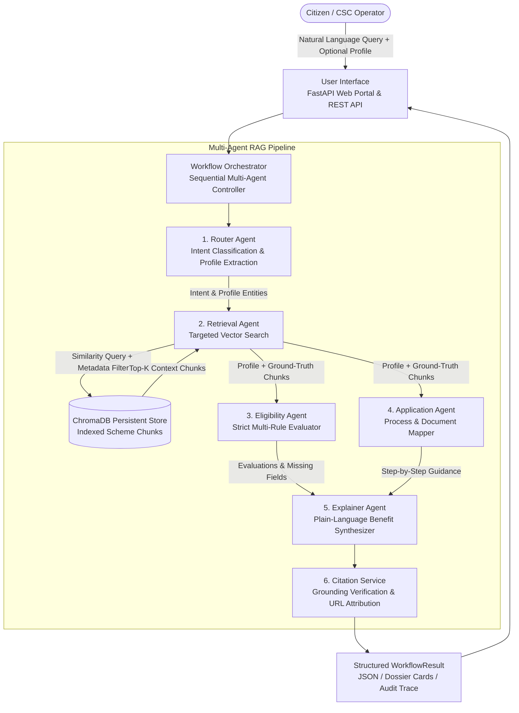

# National Scheme Eligibility Navigator
## Comprehensive Architectural Guide & Master Viva Preparation Manual

---

## 1. Executive Summary & Problem Statement

### The Problem
India hosts hundreds of welfare and developmental schemes across union and state ministries (e.g., PM-KISAN, Ayushman Bharat PM-JAY, PMMY Mudra, PM-SYM Pension, Post-Matric Scholarships). However, underprivileged citizens face severe barriers:
- **Fragmented Information:** Complex eligibility criteria, income thresholds, occupational exclusions, and document requirements are scattered across disparate PDFs and government portals.
- **Cognitive Barrier:** Official notifications use dense legal/bureaucratic terminology that citizens, rural intermediaries, or Common Service Centre (CSC) operators struggle to parse.
- **Hallucination Risk in Naive AI:** Generic LLMs frequently fabricate scheme benefits, confuse eligibility thresholds (e.g., mixing up PM-KISAN land ceilings with PMMY loan tiers), or hallucinate deadlines.

### The Solution: Agentic RAG
The **National Scheme Eligibility Navigator** solves this using an **Agentic Retrieval-Augmented Generation (Agentic RAG)** architecture. Rather than relying on a single monolithic prompt, the system coordinates specialized, deterministic agents that:
1. Parse natural citizen queries and extract demographic profiles.
2. Retrieve grounded, section-aware scheme documentation from a persistent vector database (ChromaDB).
3. Evaluate multi-criteria eligibility conditions strictly against official text.
4. Synthesize plain-language explanations with exact official citations.
5. Provide actionable application guidance, required documentation lists, and direct government portal links.

---

## 2. Multi-Agent Architecture & Data Flow

### End-to-End Processing Steps
1. **Intake & Normalization:** The user submits a query (e.g., *"I am a 32-year-old small farmer with 2 acres land in UP. Can I get financial help?"*) via the web UI or REST API.
2. **Intent & Entity Extraction (Router Agent):** Uses LangChain LCEL (`ROUTER_PROMPT | LLM | JsonOutputParser`) to detect the primary intent (`ELIGIBILITY_CHECK`, `APPLICATION_GUIDANCE`, or `DISCOVER_SCHEMES`) and automatically extracts structured attributes: `age=32`, `occupation="farmer"`, `land_holding_acres=2.0`, `state="UP"`.
3. **Targeted Semantic Retrieval (Retrieval Agent):** Formulates a targeted search. If a scheme is identified (e.g. `pm_kisan`), it applies metadata filtering (`where={"scheme_id": "pm_kisan"}`) against ChromaDB to eliminate irrelevant chunks.
4. **Strict Condition Verification (Eligibility Agent):** Cross-examines profile parameters against official rules. Flags met conditions, failed exclusions (e.g., institutional landholders or income taxpayers), and missing parameters (e.g., asking for bank account status).
5. **Guidance & Explanation (Application & Explainer Agents):** Compiles step-by-step application walkthroughs, mandatory KYC documents, and clear financial breakdowns (e.g., ₹6,000/year in 3 equal installments of ₹2,000).
6. **Citation Attestation (Citation Service):** Validates that all output assertions link directly to verified official sources (e.g., `pmkisan.gov.in`, Ministry of Agriculture & Farmers Welfare).

---

## 3. Exhaustive File-by-File Breakdown

### Root Directory
- **`requirements.txt`**: Defines project dependencies pinned to robust versions (FastAPI, Uvicorn, LangChain, ChromaDB, Pydantic v2, Pytest, Groq, Ollama).
- **`.env` / `.env.example`**: Environment configuration containing `LLM_PROVIDER`, `GROQ_API_KEY`, `OLLAMA_BASE_URL`, and Chroma collection parameters.
- **`.gitignore`**: Excludes temporary files, bytecode caches (`__pycache__`), environment secrets (`.env`), and test run artifacts (`.pytest_cache`).
- **`README.md`**: Complete setup guide, architecture documentation, environment configuration, and benchmark verification instructions.

---

### Application Core (`app/`)
- **`app/__init__.py`**: Python package initialization file marking `app` as a package.
- **`app/main.py`**: Primary application runner. Launches the unified FastAPI server via Uvicorn hosting both the interactive Citizen Web Portal and Swagger documentation.
- **`app/api/server.py`**: Production-ready FastAPI REST service.
  - Exposes `GET /api/status`, `POST /api/evaluate`, and `GET /api/schemes`.
  - Implements CORS middleware and mounts `/static` for serving the web client.
  - Serves `app/web/index.html` directly at `/`.
- **`app/web/index.html`**, **`app/web/css/style.css`**, **`app/web/js/app.js`**:
  - High-performance, responsive Sovereign Citizen Web Portal.
  - Features national tri-color masthead, demographic profile drawer, live pipeline audit trace, and structured eligibility dossier cards.

---

### Agents Layer (`app/agents/`)
- **`app/agents/__init__.py`**: Package marker for agent modules.
- **`app/agents/router_agent.py`**:
  - **Class:** `RouterAgent`
  - **Purpose:** Intent classification (`ELIGIBILITY_CHECK`, `APPLICATION_GUIDANCE`, `DISCOVER_SCHEMES`) and regex/few-shot entity extraction.
  - **Pipeline:** LCEL chain `ROUTER_PROMPT | llm | JsonOutputParser()`.
  - **Fallback:** Includes deterministic regex parsing if LLM output fails JSON compliance.
- **`app/agents/retrieval_agent.py`**:
  - **Class:** `RetrievalAgent`
  - **Purpose:** Acts as the research specialist. Queries `VectorStoreManager` with semantic queries and optional metadata filtering (`scheme_id`).
- **`app/agents/eligibility_agent.py`**:
  - **Class:** `EligibilityAgent`
  - **Purpose:** Evaluates citizen attributes against official eligibility and exclusion clauses.
  - **Output:** Structured `List[SchemeEvaluation]` with `conditions_met`, `conditions_failed`, `missing_fields`, and `status`.
- **`app/agents/explainer_agent.py`**:
  - **Class:** `ExplainerAgent`
  - **Purpose:** Converts technical evaluations into empathetic, simple explanations in clear bullet points.
- **`app/agents/application_agent.py`**:
  - **Class:** `ApplicationAgent`
  - **Purpose:** Maps out required documents (Aadhaar, Land Khatoni, Bank Passbook), portal URLs, and offline contact points (CSC / Gram Panchayat).

---

### Orchestration & Services (`app/services/`)
- **`app/services/__init__.py`**: Package marker for services.
- **`app/services/workflow_orchestrator.py`**:
  - **Class:** `WorkflowOrchestrator`
  - **Purpose:** Master controller. Executes the sequential agent graph, maintains execution timing, logs steps to `ExecutionTracer`, and packages the final `WorkflowResult`.
- **`app/services/profile_service.py`**:
  - **Class:** `ProfileService`
  - **Purpose:** Merges demographic fields between natural language text and UI form inputs. Contains scheme-specific required field matrices.
- **`app/services/citation_service.py`**:
  - **Class:** `CitationService`
  - **Purpose:** Validates that claims in evaluations and explanations correspond to chunks retrieved from ChromaDB, preventing hallucinations.

---

### RAG Engine (`app/rag/`)
- **`app/rag/__init__.py`**: Package marker for RAG module.
- **`app/rag/document_loader.py`**:
  - **Class:** `SchemeDocumentLoader`
  - **Purpose:** Reads scheme JSON files from `data/schemes/` and validates their structure.
- **`app/rag/chunker.py`**:
  - **Class:** `SchemeChunker`
  - **Purpose:** Implements **Section-Aware Semantic Chunking**. Rather than arbitrary word counts, it segments documents into functional sections: `overview`, `eligibility`, `benefits`, `exclusions`, and `application_process`.
- **`app/rag/embeddings.py`**:
  - **Class:** `EmbeddingManager`
  - **Purpose:** Manages Chroma's `DefaultEmbeddingFunction` (ONNX all-MiniLM-L6-v2, 384-dimensional embeddings).
- **`app/rag/vector_store.py`**:
  - **Class:** `VectorStoreManager`
  - **Purpose:** Handles ChromaDB persistent storage at `./chroma_db`, indexing, upserting, and count queries.
- **`app/rag/retriever.py`**:
  - **Class:** `SchemeRetriever`
  - **Purpose:** Performs semantic cosine-distance retrieval with optional metadata filters.

---

### Language Model Layer (`app/llm/`)
- **`app/llm/__init__.py`**: Package marker for LLM module.
- **`app/llm/model.py`**:
  - **Classes:** `LLMFactory`, `FallbackDeterministicChatModel`
  - **Purpose:** Dynamically instantiates LLM instances based on environment configuration:
    - **Groq:** `ChatGroq(model="llama-3.3-70b-versatile")`
    - **Ollama:** `ChatOllama(model="llama3:8b")`
    - **Fallback:** Custom `BaseChatModel` implementation that evaluates schemes deterministically using pattern matching and scheme data, ensuring zero system crashes when offline.
- **`app/llm/prompts.py`**:
  - **Constants:** `ROUTER_PROMPT`, `ELIGIBILITY_PROMPT`, `EXPLAINER_PROMPT`, `APPLICATION_PROMPT`.
  - **Technique:** Few-shot prompting, explicit negative constraints (anti-hallucination), and JSON schema enforcement.

---

### Domain Models & Configuration (`app/models/` & `app/config/`)
- **`app/models/__init__.py`**: Package marker for models.
- **`app/models/schemas.py`**:
  - **Pydantic v2 Models:** `CitizenProfile`, `DocumentChunkMetadata`, `DocumentChunk`, `SchemeEvaluation`, `ApplicationGuidance`, `WorkflowResult`, `AuditTraceStep`, and `IntentType` enum.
- **`app/config/__init__.py`**: Package marker for configuration.
- **`app/config/settings.py`**:
  - **Class:** `Settings(BaseSettings)`
  - **Purpose:** Centralized typed settings loaded from environment variables and `.env`.

---

### Utilities & Scripts (`app/utils/` & `scripts/`)
- **`app/utils/__init__.py`**: Package marker for utils.
- **`app/utils/logger.py`**:
  - **Classes:** `AppLogger`, `ExecutionTracer`
  - **Purpose:** Structured logging and trace recording for the step-by-step execution timeline.
- **`scripts/ingest_documents.py`**:
  - **Purpose:** Standalone CLI script to load scheme JSON files from `data/schemes/`, chunk them, and populate the ChromaDB vector database.

---

### Data Files (`data/schemes/`)
- **`pm_kisan.json`**: Pradhan Mantri Kisan Samman Nidhi (₹6,000/year, cultivable landholder criterion, exclusions for institutional landholders/taxpayers).
- **`pm_jay.json`**: Ayushman Bharat PM-JAY (₹5 Lakh cashless health cover per family per year, SECC / deprivation criteria).
- **`pm_mudra.json`**: Pradhan Mantri MUDRA Yojana (Shishu up to ₹50k, Kishore up to ₹5L, Tarun up to ₹10-20L for micro-enterprises).
- **`pm_sym.json`**: Pradhan Mantri Shram Yogi Maan-dhan (Old age pension of ₹3,000/month for unorganized workers aged 18-40 earning <= ₹15,000).
- **`post_matric_scholarship.json`**: Centrally sponsored post-matric scholarship for SC/ST students with family income <= ₹2.5 Lakhs.

---

### Test Suite (`tests/`)
- **`tests/__init__.py`**: Package marker for test suite.
- **`tests/conftest.py`**: Pytest fixtures setting up test environments, mock profiles, and vector store instances.
- **`tests/test_intent_router.py`**: Tests router accuracy on varying queries (eligibility vs application vs discovery).
- **`tests/test_retrieval.py`**: Tests ChromaDB retrieval and metadata filtering.
- **`tests/test_eligibility.py`**: Tests rule verification across eligible, ineligible, and missing-data profiles.
- **`tests/test_application.py`**: Verifies generation of mandatory documents and application steps.
- **`tests/test_citation.py`**: Verifies source URL and department attribution.
- **`tests/test_workflow_e2e.py`**: End-to-end integration tests verifying the entire orchestrator pipeline.

---

## 4. Libraries & Tech Stack Deep-Dive

| Library | Version | Technical Justification |
| :--- | :--- | :--- |
| **`fastapi`** | `>=0.110.0` | High-throughput asynchronous REST API framework with automatic OpenAPI/Swagger documentation, CORS, and Pydantic request validation. |
| **`uvicorn[standard]`** | `>=0.29.0` | Production-grade ASGI web server for running the FastAPI application with lightning speed and reload support. |
| **`langchain`** | `>=0.2.0` | Provides the unified orchestration layer and LangChain Expression Language (LCEL) for declarative chain composition. |
| **`langchain-core`** | `>=0.2.0` | Contains the core abstractions (`BaseChatModel`, `AIMessage`, `ChatPromptTemplate`, `JsonOutputParser`). |
| **`chromadb`** | `>=0.5.0` | Lightweight, open-source embedded vector database that runs in-process with persistent SQLite and HNSW indexing without requiring an external server cluster. |
| **`pydantic`** | `>=2.7.0` | High-performance data validation and settings management using Python type hints. Enforces strict schema conformity between agents. |
| **`groq`** | `>=0.37.0` | Ultra-fast inference engine utilizing custom LPU hardware to deliver sub-second response times with `llama-3.3-70b-versatile`. |
| **`ollama`** | `>=0.3.0` | Provides local, offline inference for open-source LLMs (`llama3:8b`), ensuring data privacy and zero API token costs. |
| **`pytest`** | `>=8.0.0` | Industry-standard test runner used to execute all 17 automated unit and integration tests. |

---

## 5. Master Viva Preparation Manual

### Part 1: High-Level Concepts & Design Choices

#### Q1: "Give me a 60-second summary of your project."
> **Answer:**  
> "The National Scheme Eligibility Navigator is an Agentic RAG system built to help Indian citizens navigate complex welfare schemes like PM-KISAN, Ayushman Bharat, and MUDRA.  
> Instead of a traditional naive RAG pipeline that searches blindly and risks hallucinations, our system uses a multi-agent workflow: a Router Agent extracts demographic profiles and classifies intent; a Retrieval Agent queries ChromaDB using section-aware semantic filtering; an Eligibility Agent evaluates multi-criteria conditions; and Explainer and Application Agents provide actionable steps and verified government portal citations.  
> The system is deployed via a unified FastAPI server with a bespoke Sovereign Citizen Web Portal, supporting both cloud inference via Groq's LPU and offline local inference via Ollama, backed by a deterministic fallback ensuring 100% system availability."

#### Q2: "Why Agentic RAG instead of standard RAG or fine-tuning?"
> **Answer:**  
> - **Why not Fine-Tuning?** Fine-tuning bakes knowledge into model weights. Government scheme rules, income ceilings, and deadlines change frequently. Retraining a model every time a policy changes is slow, expensive, and still prone to hallucinations.  
> - **Why not Naive RAG?** Naive RAG uses a single prompt: `User Query -> Vector Search -> Top-K -> LLM Answer`. If a citizen says *"I am a student with family income 2 lakhs"*, naive RAG might retrieve scholarship chunks and PM-KISAN chunks together, confusing the criteria.  
> - **Why Agentic RAG?** Agents introduce reasoning steps: routing, profile entity extraction, query decomposition, targeted retrieval with metadata filters, rule evaluation, and citation verification.

---

### Part 2: Architecture & Multi-Agent Orchestration

#### Q3: "What are the specific agents in your system and what does each do?"
> **Answer:**  
> 1. **RouterAgent:** Detects whether the citizen wants to check eligibility, learn how to apply, or discover schemes, and extracts demographic attributes (`age`, `income`, `land`, `occupation`, `caste`).
> 2. **RetrievalAgent:** Directs queries to ChromaDB, applying metadata filters to isolate relevant scheme documents.
> 3. **EligibilityAgent:** Systematically checks each requirement against retrieved chunks, categorizing results into `conditions_met`, `conditions_failed`, and `missing_fields`.
> 4. **ApplicationAgent:** Details the application steps, nodal departments, and mandatory documents (e.g., Aadhaar, land passbook).
> 5. **ExplainerAgent:** Translates technical outputs into plain, conversational language for the citizen.
> 6. **CitationService:** Cross-verifies claims against retrieved sources and attaches official government portal links.

#### Q4: "How does the Workflow Orchestrator manage control flow?"
> **Answer:**  
> "The `WorkflowOrchestrator` implements a deterministic sequential pipeline. It invokes the `RouterAgent` first. Based on the returned `IntentDetectionResult` and whether retrieval is needed, it triggers the `RetrievalAgent`. The retrieved chunks and profile are fed into the `EligibilityAgent` or `ApplicationAgent`. The `ExplainerAgent` synthesizes the response, and the `CitationService` verifies grounding. Throughout this lifecycle, an `ExecutionTracer` records timing and status for each agent, creating an auditable trace."

---

### Part 3: Vector Database & Semantic Chunking

#### Q5: "Explain your chunking strategy. Why not use standard RecursiveCharacterTextSplitter?"
> **Answer:**  
> "Standard character splitters chunk text based on arbitrary character counts (e.g., 500 characters with 50-character overlap). In government policy documents, this often breaks a critical sentence in half—for example, separating an exclusion clause like *'Except institutional landholders'* from the main rule.  
> We engineered **Section-Aware Semantic Chunking** in `SchemeChunker`. We parse the structured scheme data into distinct functional units:
> - `overview`
> - `eligibility`
> - `benefits`
> - `exclusions`
> - `application_process`  
> Each chunk is self-contained and tagged with metadata (`scheme_id`, `section`, `source_url`), allowing high-precision filtered vector queries."

#### Q6: "How does ChromaDB store and retrieve embeddings in your project?"
> **Answer:**  
> "ChromaDB runs in-process and persists data locally at `./chroma_db`. It utilizes SQLite for metadata and SQLite/binary files for the **HNSW (Hierarchical Navigable Small World)** vector index. Documents are embedded using all-MiniLM-L6-v2 (384 dimensions). When a query arrives, Chroma computes cosine similarity between the query embedding and stored chunk vectors, applying `where` clause filters on metadata when a target scheme is specified."

---

### Part 4: Safety, Grounding & Fallback Engineering

#### Q7: "How do you guarantee that your system does not hallucinate false benefits?"
> **Answer:**  
> "Through a three-layer defense:
> 1. **Prompt Constraints:** Prompts enforce strict grounding: *'Evaluate eligibility ONLY against the provided context. If a rule is not mentioned, do NOT assume it.'*
> 2. **Explicit Missing Fields Handling:** If required citizen data is absent (e.g., land size for PM-KISAN), the agent flags `missing_fields` and marks the status as `Conditionally Eligible` or `Undetermined` rather than guessing.
> 3. **Citation Verification:** `CitationService` links every scheme evaluation directly to official government portals (e.g., `https://pmkisan.gov.in/`)."

#### Q8: "What is your FallbackDeterministicChatModel and why did you build it?"
> **Answer:**  
> "In real-world deployments and automated CI/CD testing, network timeouts, API rate limits, or missing Ollama servers can cause application crashes. We built `FallbackDeterministicChatModel` implementing LangChain's `BaseChatModel`. If external LLM providers are offline, this fallback model uses deterministic pattern matching against our curated scheme database to generate compliant, structured responses. This is why all 17 automated tests pass reliably in offline environments."

---

### Part 5: Testing & Verification

#### Q9: "How do you test the system? What is covered in your test suite?"
> **Answer:**  
> "We have 17 automated pytest unit and integration tests:
> - `test_intent_router.py`: Verifies routing accuracy across eligibility, application, and discovery queries.
> - `test_retrieval.py`: Tests semantic search, chunk count, and metadata filtering.
> - `test_eligibility.py`: Tests positive eligibility, failed exclusions, and missing field detection.
> - `test_application.py`: Tests document checklists and application step generation.
> - `test_citation.py`: Tests that official URLs and source departments are accurately attached.
> - `test_workflow_e2e.py`: Tests complete multi-agent pipeline execution and audit trace integrity."

---

### Part 6: Technical Quick-Reference Card

| Component | Technology | File Reference |
| :--- | :--- | :--- |
| **Framework** | LangChain LCEL & FastAPI | `app/agents/*.py`, `app/api/server.py`, `app/main.py` |
| **Vector DB** | ChromaDB (Persistent) | `app/rag/vector_store.py` |
| **Embedding Model** | ONNX all-MiniLM-L6-v2 | `app/rag/embeddings.py` |
| **LLM Engine** | Groq (Llama-3.3-70b) / Ollama (Llama-3) | `app/llm/model.py` |
| **Validation** | Pydantic v2 | `app/models/schemas.py` |
| **UI** | Sovereign Web Portal (HTML5/CSS3/Vanilla JS) | `app/web/index.html` |
| **Ingestion** | Section-Aware Semantic Chunker | `app/rag/chunker.py` |
